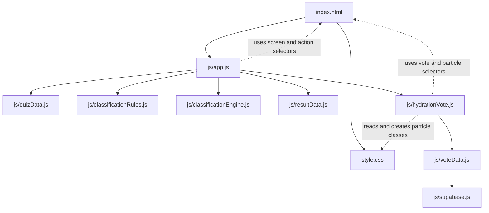

# Project Map

這份文件依照目前 repo 的實際程式與相依關係整理，讓修改需求能快速對應到正確檔案。專案是 GitHub Pages 可部署的 static site，沒有 Node.js backend、package manifest 或 build pipeline。投票共用資料透過 Supabase；quiz classification 與投票資料彼此分離。

## 風險標籤

- **高**：修改可能影響其他模組的資料契約、流程或 Supabase 操作；應同步檢查相依檔案。
- **中**：通常限於某個頁面，但 HTML selector、CSS class 或互動狀態也被其他檔案使用。
- **低**：不影響執行期程式。文件內容或法律文字仍應審慎維護。

## 依賴關係

`app.js` 將 `quizData.questions`、答案、`runnerTypes` 與 `classificationRules` 傳給分類器；分類器不直接 import 這些資料。投票模組不參與 runner type 計算。

## 檔案地圖

| 檔案 | 負責內容與可修改範圍 | 直接依賴／相依契約 | 風險 |
| --- | --- | --- | --- |
| [`index.html`](index.html) | 頁面骨架、各 screen、按鈕、投票選項與 DOM selector。修改區塊結構、可見文字 fallback、`data-action`、`data-vote-*` 或 `id`。 | 載入 `style.css` 與 `js/app.js`。`app.js`、`hydrationVote.js` 依賴這裡的 selector；class 也連到 CSS。 | **中**：改 selector 或 action 名稱時，必須同步檢查 JS；單純調整靜態文字通常較低風險。 |
| [`style.css`](style.css) | 全站色彩、字體、排版、動畫、手機／桌面斷點，以及投票箱和球體外觀。 | 依賴 `index.html` 的 class；球體 class 由 `hydrationVote.js` 動態建立。 | **中**：改色彩、間距通常只影響外觀；改 `.screen[hidden]`、投票容器尺寸、粒子定位或動畫 class 可能影響流程呈現與球堆。 |
| [`js/app.js`](js/app.js) | Quiz 狀態、題目 rendering、答案保存、分類呼叫、結果呈現、screen 導覽與共用語言切換。 | import `quizData.js`、`classificationRules.js`、`classificationEngine.js`、`resultData.js`、`hydrationVote.js`；使用 `index.html` 的 `data-action`、screen id 與 DOM selector。 | **高**：核心流程入口。改導覽、答案或分類呼叫時會影響 quiz／result；投票頁語言與進出也由此串接。 |
| [`js/quizData.js`](js/quizData.js) | Q1–Q6 問題、選項、中英文文案、`traits`、`sustainability`、`isMeme` 與 `runnerTypes`。 | `app.js` 讀取題目及選項；分類時由 app 將題目資料傳給 `classificationEngine.js`。題目 id、答案 key 與結果資料必須一致。 | **高**：改 id、trait、題目結構會影響 rendering、答案查找或 runner type；只改既有選項文案的風險較低。 |
| [`js/classificationRules.js`](js/classificationRules.js) | runner type 平手時的優先順序與分類規則設定。 | `app.js` 將 rules 傳入 `classificationEngine.js`；runner type 名稱需和 `quizData.js`、`resultData.js` 對應。 | **高**：修改 tie-break 順序會改變平手結果；新增／更名分類需同步檢查資料與結果 key。 |
| [`js/classificationEngine.js`](js/classificationEngine.js) | 累計 trait 分數、挑選最高分 runner type、套用 tie-break、檢查 sustainability flag。 | 由 `app.js` 呼叫，接收 questions、answers、runnerTypes、rules；回傳 `runnerType`、`sustainability`、`scores`。 | **高**：輸入／輸出格式是 app 與結果呈現的契約；修改演算法可能改變所有結果分類。 |
| [`js/resultData.js`](js/resultData.js) | 三種 runner type 的中英文結果文案、補水建議、永續版本、圖片欄位、CTA 與 Q6 label。 | `app.js` 依分類結果的 `runnerType` 查找；物件 key 必須與 `quizData.js` 的 runner type 對應。 | **中**：改文案與圖片多半只影響結果內容；改 key 或欄位名稱會造成結果頁讀取失敗。 |
| [`js/hydrationVote.js`](js/hydrationVote.js) | 投票頁雙語內容、票數 rendering、可重選狀態、匿名 voter id 保存、粒子顏色比例、隨機支撐式堆積、容器高度映射、落球動畫、Realtime 與 polling。 | import `voteData.js`；透過 `data-vote-*` selector 操作 `index.html`；球體 class 與 keyframe 需對應 `style.css`。由 `app.js` 呼叫初始化及語言更新。 | **高**：同時連接投票互動、HTML selector、CSS class 和資料 API；改投票流程或 renderer 後應驗證 demo 與真實模式。 |
| [`js/voteData.js`](js/voteData.js) | `DEMO_MODE`、development seed、Supabase 票數查詢、同一 voter token 的選項更新與 Realtime INSERT／UPDATE 訂閱。 | import `supabase.js`；呼叫 `cast_vote` RPC。Supabase `votes` table 需有唯一的 `voter_key_hash`；欄位授權與 option constraint 要符合 README migration。被 `hydrationVote.js` 使用。 | **高**：改 option、RPC 參數、雜湊欄位或查詢方式需同步資料庫函式／policy 與投票頁；只切換 demo 設定不需改分類。 |
| [`js/supabase.js`](js/supabase.js) | Supabase client 初始化、Project URL／公開 anon key 與 client auth 設定。 | 只由 `voteData.js` 使用；依賴 Supabase 專案設定及 CDN SDK。 | **中**：只影響投票後端連線；設定只可使用公開 anon／publishable key，不能放 `service_role` key。 |
| [`README.md`](README.md) | 專案說明、本機啟動、Supabase 建表與 RLS、Realtime、demo 測試與清票方式。 | 說明需與 HTML、JS、Supabase SQL 和實際設定保持一致。 | **低**：文件變更不影響執行期；設定文件錯誤可能導致部署或測試失敗。 |
| [`PROJECT_MAP.md`](PROJECT_MAP.md) | 檔案職責、依賴圖、修改風險與需求定位指南。 | 依賴 repo 現有程式結構；功能或檔案異動後應同步更新本地圖。 | **低**：不影響執行期；內容過期會讓後續修改定位錯誤。 |
| [`LICENSE`](LICENSE) | MIT License 授權文字。 | 無程式依賴。 | **低（執行期）**：不影響功能；修改授權文字會影響專案法律條款，請勿當一般文件任意調整。 |

## 依需求定位修改

| 想修改的細節 | 主要修改位置 | 需要連帶檢查 |
| --- | --- | --- |
| 題目、選項、提示文字或 quiz 中英內容 | `js/quizData.js` 的 `questions` | 題目／選項 id 若改名，檢查 `js/app.js` 的 q6 查找與答案流程。 |
| 哪些答案加分、跑者分類或平手優先順序 | `js/quizData.js` 的 `traits`、`js/classificationRules.js`、`js/classificationEngine.js` | `js/resultData.js` 的 runner type key；維持 quiz 選項與投票選項分離。 |
| Runner result 標題、描述、建議、圖片或 CTA | `js/resultData.js` | 圖片路徑與中英文欄位；通常不需改分類器。 |
| 開始、下一題、返回、重測、結果／投票頁導覽 | `js/app.js` | `index.html` 的 `data-action` 與 screen id。 |
| 頁面區塊、按鈕、DOM hook、靜態 fallback 文字 | `index.html` | `app.js`／`hydrationVote.js` 使用的 selector，以及 `style.css` class。 |
| 顏色、間距、字體、斷點與整體響應式樣式 | `style.css` | 若改 class 名稱，需同步檢查 HTML 與 JS 動態粒子 class。 |
| 投票頁標題、三個選項顯示文案、loading／錯誤／感謝文案 | `js/hydrationVote.js` 的 `copy` | `index.html` 有首次載入 fallback；保持三種選項語意與 option key 不變。 |
| 球大小、堆積、顏色混合、容器高度、球數上限、落下動畫 | `js/hydrationVote.js` 的粒子常數與 packing／render 函式；`style.css` 的 `.vessel-particle`、`.vote-vessel`、`@keyframes particle-drop` | selector、CSS class 與容器尺寸需一致；DOM 上限由 `MAX_VISUAL_PARTICLES` 控制。 |
| 投票讀取／寫入、同瀏覽器重選更新原票與 Realtime 訂閱行為 | `js/voteData.js` | `js/hydrationVote.js` 呼叫資料 API；Supabase `cast_vote` RPC、`voter_key_hash` index、RLS 與 option constraint。 |
| Supabase Project URL、公開 key 或 client 初始化 | `js/supabase.js` | 只使用公開 anon／publishable key；schema／RLS 說明看 README。 |
| DEMO seed、開關或測試方式 | `js/voteData.js` 的 `DEMO_MODE`、`DEMO_SEED_COUNTS` | 頁面 demo 標示在 `index.html`／`hydrationVote.js`；測試說明在 README。 |
| Supabase table、RLS、Realtime 或清空測試票 | Supabase Dashboard／SQL Editor；操作步驟在 `README.md` | 更動 schema／option constraint 前，先檢查 `voteData.js` 和投票 option key。 |

### 修改前的快速判斷

- 只改文字或視覺，優先限定在文案資料檔或 CSS，避免順手改動 id、option key、DOM selector。
- 改 quiz 分類只調整 quiz 資料／分類器／規則與結果資料；投票選項與 Supabase 不參與 runner type 計算。
- 改投票 option key 是跨前端與資料庫的高風險變更，需同步前端三個 option key、Supabase constraint／policy 與既有資料策略。
- 改 HTML 的 `data-*`、`id` 或 class 前，先搜尋同名 selector；這些屬性是 HTML、JavaScript、CSS 間的介面契約。