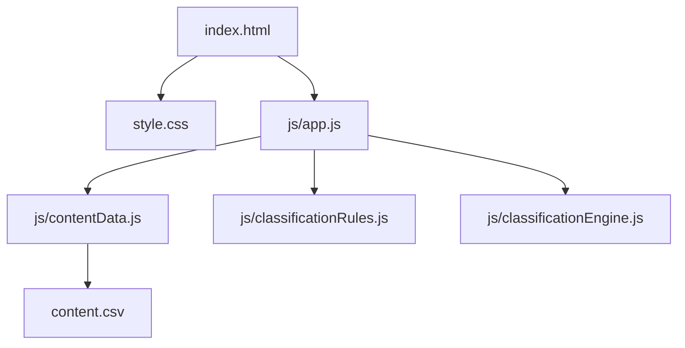

# Project Map

本文件依照目前 repo 的實際程式與相依關係整理。專案是可部署至 GitHub Pages 的 static site，沒有 Node.js backend、package manifest 或 build pipeline。測驗與分類皆在瀏覽器端執行，測驗題目及結果由 CSV 提供。

## 依賴關係

`app.js` 啟動時透過 `contentData.js` 載入 `content.csv`，再將題目、答案、`runnerTypes` 與 `classificationRules` 傳給分類器。

## 檔案地圖

| 檔案 | 負責內容與可修改範圍 | 直接依賴／相依契約 |
| --- | --- | --- |
| [`index.html`](index.html) | 頁面骨架、首頁／測驗／結果畫面、按鈕及 DOM selector。 | 載入 `style.css` 與 `js/app.js`；`app.js` 依賴 screen id、`data-action` 和其他 DOM selector。 |
| [`style.css`](style.css) | 全站色彩、字體、排版、互動狀態、動畫及響應式斷點。 | 依賴 `index.html` 的 class；調整隱藏狀態或 selector 樣式時要確認 screen 導覽仍正常。 |
| [`js/app.js`](js/app.js) | Quiz 狀態、題目 rendering、答案保存、分類呼叫、結果呈現、screen 導覽與共用語言切換。 | import `contentData.js`、`classificationRules.js`、`classificationEngine.js`；使用 HTML 的 action 與 screen selector。 |
| [`js/contentData.js`](js/contentData.js) | 載入並解析 `content.csv`，驗證標頭／欄數及必要資料，再建構 quiz、結果與 UI 文案。 | CSV 欄名與順序由 `CSV_COLUMNS` 驗證；runner type、traits、題目和選項 id 須符合資料契約。 |
| [`content.csv`](content.csv) | Quiz 題目、選項、中英文內容、分類 traits、永續／meme 標記、結果文案及 UI 標籤；是執行期內容來源。 | 由 `js/contentData.js` 以 `fetch` 載入；保留欄名與欄位順序。 |
| [`js/classificationRules.js`](js/classificationRules.js) | runner type 平手時的優先順序與分類規則設定。 | runner type 名稱需和 `content.csv` 的 result id 對應。 |
| [`js/classificationEngine.js`](js/classificationEngine.js) | 累計 trait 分數、挑選最高分 runner type、套用 tie-break、檢查 sustainability flag。 | 由 `app.js` 呼叫，回傳 `runnerType`、`sustainability` 與 `scores`。 |
| [`js/quizData.js`](js/quizData.js) | 舊版 JavaScript 題目資料，目前 app 不匯入；執行期題目請修改 `content.csv`。 | 無執行期引用。 |
| [`js/resultData.js`](js/resultData.js) | 舊版 JavaScript 結果資料，目前 app 不匯入；執行期結果請修改 `content.csv`。 | 無執行期引用。 |
| [`README.md`](README.md) | 專案說明、本機預覽與內容修改入口。 | 說明需與目前程式架構保持一致。 |
| [`LICENSE`](LICENSE) | MIT License 授權文字。 | 無程式依賴。 |

## 分類行為與資料契約

- runner type 固定為 `experience`、`lifestyle`、`performance`，須同時存在於 `classificationRules.js` 與 `content.csv` 的 `result` 列 `id`。
- 分類器依答案選項的 `traits` 累計分數；Q1–Q5 參與計分。分數最高者勝出，平手依 `classificationRules.js` 的順序：`experience` > `lifestyle` > `performance`。
- `sustainability=true` 是獨立 flag，不加進三向度分數；任一題已選選項帶有此 flag，結果就會使用永續版本。每種 runner type 都需在 CSV 有相同 `id` 的 `result_sustainability` 列。
- 分類在完成測驗時依目前所有答案重新計算；返回修改答案會以新答案取代舊答案，不會重複累加分數。

以上 tie-break 與計分方式是活動 prototype 的 placeholder，不代表正式心理測量結果。

## 編輯題目與結果 CSV

直接用試算表或文字編輯器修改 [`content.csv`](content.csv)，存檔後重新整理頁面即可載入更新內容。欄名及順序由 [`js/contentData.js`](js/contentData.js) 驗證，請保留第一列完整不動；此檔以 UTF-8 編碼保存，不要另存成分號分隔格式。若欄位內有逗號、雙引號或換行，需使用標準 CSV 引號格式；試算表通常會自動處理。

每列的 `type` 決定用途：

| `type` | 用途與主要欄位 |
| --- | --- |
| `question` | 一題。`id` 是題目 key；`zh`、`en` 是題目文字。 |
| `option` | 一個選項。`parent_id` 指向題目 `id`；`id` 是答案 key；`zh`、`en` 是唯一的選項文字。 |
| `result` | 一種 runner type。`id` 必須與分類器使用的 type key 一致；`zh`、`en` 是結果標題，`description_zh`、`description_en` 是結果描述；補水內容使用 `hydration_title_*`、`hydration_description_*`，CTA 使用 `cta_*`，圖片使用 `image_src` 與 `image_alt_*`。 |
| `result_sustainability` | 對應 `id` 的永續結果版本；`zh`、`en` 是標題，`description_zh`、`description_en` 是描述。每個 `result` 都必須有一列。 |
| `ui` | 測驗／結果介面的雙語標籤；`id` 是 UI key，文字放在 `zh`、`en`。 |

修改選項分類時，`traits` 可填 `experience`、`lifestyle`、`performance`，多個值以 `|` 分隔；`sustainability` 與 `is_meme` 只接受小寫 `true` 或 `false`。永續選項以 `sustainability=true` 標示，meme 選項以 `is_meme=true` 標示；不要只靠選項文字判斷分類。空欄代表沒有內容／旗標為 false。新增或更名題目、選項、runner type 時，需一併確認分類規則與分類器契約，避免 key 不相符。

編輯後依 README 的本機預覽方式啟動 HTTP server，再重新整理頁面。不要直接以 `file://` 開啟 `index.html`，因瀏覽器需要透過 `fetch` 讀取 CSV；若標頭、欄數或必要資料不合法，開始按鈕會維持停用並在 console 顯示錯誤。

## 依需求定位修改

| 想修改的細節 | 主要修改位置 | 需要連帶檢查 |
| --- | --- | --- |
| 題目、選項、提示文字或 quiz 中英內容 | `content.csv` 的 `question`、`option` 列 | `parent_id` 必須指向題目 id；id 若改名，檢查答案流程與分類契約。 |
| 哪些答案加分、跑者分類或平手優先順序 | `content.csv` 的 `traits`、`sustainability`、`is_meme` 欄；`js/classificationRules.js`、`js/classificationEngine.js` | `result` 列的 runner type id。 |
| Runner result 標題、描述、建議或圖片 | `content.csv` 的 `result`、`result_sustainability` 列 | 圖片路徑與中英文欄位；每種 runner type 都需有永續結果列。 |
| 題目／結果內容 CSV 格式、欄位映射或載入驗證 | `js/contentData.js` | `content.csv` 的欄名與欄位順序；確認 CSV 可載入且題目／結果都成功建構。 |
| 開始、下一題、返回、重測及頁面導覽 | `js/app.js` | `index.html` 的 `data-action` 與 screen id。 |
| 頁面區塊、按鈕、DOM hook、靜態 fallback 文字 | `index.html` | `app.js` 使用的 selector，以及 `style.css` class。 |
| 顏色、間距、字體、斷點與整體響應式樣式 | `style.css` | 若改 class 名稱，需同步檢查 HTML selector。 |

### 修改前的快速判斷

- 只改題目或結果文案，直接修改 `content.csv` 對應列；只改視覺則限於 CSS，避免順手改動 id 或 DOM selector。
- 改 quiz 分類需一起檢查 `content.csv` 的 traits／flags、分類器與規則。
- 改 HTML 的 `data-*`、`id` 或 class 前，先搜尋同名 selector；這些屬性是 HTML、JavaScript、CSS 間的介面契約。
