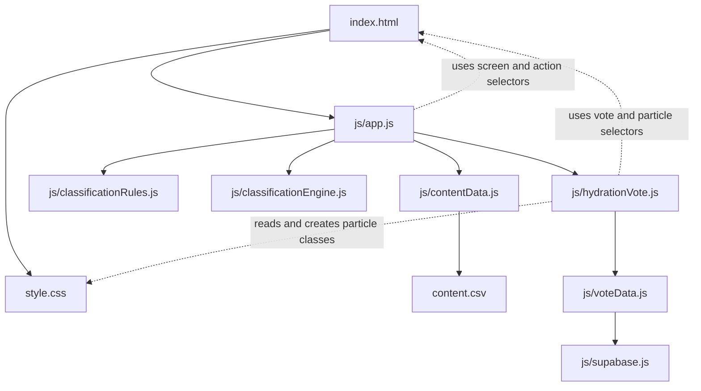

# Project Map

這份文件依照目前 repo 的實際程式與相依關係整理，讓修改需求能快速對應到正確檔案。專案是 GitHub Pages 可部署的 static site，沒有 Node.js backend、package manifest 或 build pipeline。投票共用資料透過 Supabase；quiz classification 與投票資料彼此分離。

## 風險標籤

- **高**：修改可能影響其他模組的資料契約、流程或 Supabase 操作；應同步檢查相依檔案。
- **中**：通常限於某個頁面，但 HTML selector、CSS class 或互動狀態也被其他檔案使用。
- **低**：不影響執行期程式。文件內容或法律文字仍應審慎維護。

## 依賴關係

`app.js` 啟動時透過 `contentData.js` 載入 `content.csv`，再將題目、答案、`runnerTypes` 與 `classificationRules` 傳給分類器；分類器不直接讀取 CSV。投票模組不參與 runner type 計算。

## 檔案地圖

| 檔案 | 負責內容與可修改範圍 | 直接依賴／相依契約 | 風險 |
| --- | --- | --- | --- |
| [`index.html`](index.html) | 頁面骨架、各 screen、按鈕、投票選項與 DOM selector。修改區塊結構、可見文字 fallback、`data-action`、`data-vote-*` 或 `id`。 | 載入 `style.css` 與 `js/app.js`。`app.js`、`hydrationVote.js` 依賴這裡的 selector；class 也連到 CSS。 | **中**：改 selector 或 action 名稱時，必須同步檢查 JS；單純調整靜態文字通常較低風險。 |
| [`content.csv`](content.csv) | Quiz 題目、選項、中英文內容、分類 traits、永續／meme 標記、結果頁文案、圖片替代文字與結果頁 UI 文案；是題目及結果的執行期內容來源。 | 由 `js/contentData.js` 以 `fetch` 載入。欄名及欄位順序必須符合載入器；runner type id、traits 和題目／選項 id 需符合分類器契約。 | **高**：欄位錯位或 ID／traits 拼錯會造成載入失敗或分類改變；僅修改既有文案通常較低風險。 |
| [`style.css`](style.css) | 全站色彩、字體、排版、動畫、手機／桌面斷點，以及投票箱和球體外觀。 | 依賴 `index.html` 的 class；球體 class 由 `hydrationVote.js` 動態建立。 | **中**：改色彩、間距通常只影響外觀；改 `.screen[hidden]`、投票容器尺寸、粒子定位或動畫 class 可能影響流程呈現與球堆。 |
| [`js/app.js`](js/app.js) | Quiz 狀態、題目 rendering、答案保存、分類呼叫、結果呈現、screen 導覽與共用語言切換。 | import `contentData.js`、`classificationRules.js`、`classificationEngine.js`、`hydrationVote.js`；啟動時載入 `content.csv`，並使用 `index.html` 的 `data-action`、screen id 與 DOM selector。 | **高**：核心流程入口。改導覽、答案或分類呼叫時會影響 quiz／result；投票頁語言與進出也由此串接。 |
| [`js/contentData.js`](js/contentData.js) | 取得並解析 `content.csv`，驗證標頭／欄數及必要資料，再建構 quiz、結果、永續結果與 UI 文案物件。 | `app.js` 呼叫 `loadContent()`；CSV 標頭與順序由 `CSV_COLUMNS` 固定，改 schema 時要同步調整解析器。 | **高**：格式或映射錯誤會阻止內容載入；修改解析規則時應驗證 CSV 到資料物件的映射。 |
| [`js/quizData.js`](js/quizData.js) | 舊版 JavaScript 題目資料；目前 app 不再匯入，執行期題目請改 `content.csv`。 | 無目前執行期引用；保留檔案不代表它會覆寫 CSV。 | **低**：修改此檔不會更新目前頁面內容，避免將它誤認為資料來源。 |
| [`js/classificationRules.js`](js/classificationRules.js) | runner type 平手時的優先順序與分類規則設定。 | `app.js` 將 rules 傳入 `classificationEngine.js`；runner type 名稱需和 `content.csv` 的 `result` id 對應。 | **高**：修改 tie-break 順序會改變平手結果；新增／更名分類需同步檢查 CSV 的 traits 與 result id。 |
| [`js/classificationEngine.js`](js/classificationEngine.js) | 累計 trait 分數、挑選最高分 runner type、套用 tie-break、檢查 sustainability flag。 | 由 `app.js` 呼叫，接收 questions、answers、runnerTypes、rules；回傳 `runnerType`、`sustainability`、`scores`。 | **高**：輸入／輸出格式是 app 與結果呈現的契約；修改演算法可能改變所有結果分類。 |
| [`js/resultData.js`](js/resultData.js) | 舊版 JavaScript 結果資料；目前 app 不再匯入，執行期結果內容請改 `content.csv`。 | 無目前執行期引用；result row 的 id 必須和分類器輸出的 runner type 一致。 | **低**：修改此檔不會更新目前頁面內容，避免將它誤認為資料來源。 |
| [`js/hydrationVote.js`](js/hydrationVote.js) | 投票頁雙語內容、票數 rendering、可重選狀態、匿名 voter id 保存、粒子顏色比例、隨機支撐式堆積、容器高度映射、落球動畫、Realtime 與 polling。 | import `voteData.js`；透過 `data-vote-*` selector 操作 `index.html`；球體 class 與 keyframe 需對應 `style.css`。由 `app.js` 呼叫初始化及語言更新。 | **高**：同時連接投票互動、HTML selector、CSS class 和資料 API；改投票流程或 renderer 後應驗證 demo 與真實模式。 |
| [`js/voteData.js`](js/voteData.js) | `DEMO_MODE`、development seed、Supabase 票數查詢、同一 voter token 的選項更新與 Realtime INSERT／UPDATE 訂閱。 | import `supabase.js`；呼叫 `cast_vote` RPC。Supabase `votes` table 需有唯一的 `voter_key_hash`；欄位授權與 option constraint 要符合 README migration。被 `hydrationVote.js` 使用。 | **高**：改 option、RPC 參數、雜湊欄位或查詢方式需同步資料庫函式／policy 與投票頁；只切換 demo 設定不需改分類。 |
| [`js/supabase.js`](js/supabase.js) | Supabase client 初始化、Project URL／公開 anon key 與 client auth 設定。 | 只由 `voteData.js` 使用；依賴 Supabase 專案設定及 CDN SDK。 | **中**：只影響投票後端連線；設定只可使用公開 anon／publishable key，不能放 `service_role` key。 |
| [`README.md`](README.md) | 專案說明、本機啟動、Supabase 建表與 RLS、Realtime、demo 測試與清票方式。 | 說明需與 HTML、JS、Supabase SQL 和實際設定保持一致。 | **低**：文件變更不影響執行期；設定文件錯誤可能導致部署或測試失敗。 |
| [`PROJECT_MAP.md`](PROJECT_MAP.md) | 檔案職責、依賴圖、修改風險與需求定位指南。 | 依賴 repo 現有程式結構；功能或檔案異動後應同步更新本地圖。 | **低**：不影響執行期；內容過期會讓後續修改定位錯誤。 |
| [`LICENSE`](LICENSE) | MIT License 授權文字。 | 無程式依賴。 | **低（執行期）**：不影響功能；修改授權文字會影響專案法律條款，請勿當一般文件任意調整。 |

## 編輯題目與結果 CSV

直接用試算表或文字編輯器修改 [`content.csv`](content.csv)，存檔後重新整理頁面即可載入更新內容。欄名及順序由 [`js/contentData.js`](js/contentData.js) 驗證，請保留第一列完整不動；此檔以 UTF-8 編碼保存，不要另存成分號分隔格式。若欄位內有逗號、雙引號或換行，需使用標準 CSV 引號格式；試算表通常會自動處理。

每列的 `type` 決定用途：

| `type` | 用途與主要欄位 |
| --- | --- |
| `question` | 一題。`id` 是題目 key；`zh`、`en` 是題目文字。 |
| `option` | 一個選項。`parent_id` 指向題目 `id`；`id` 是答案 key；`zh`、`en` 是選項文字；`detail_zh`、`detail_en` 是可選補充說明。 |
| `result` | 一種 runner type。`id` 必須與分類器使用的 type key 一致；`zh`、`en` 是結果標題，`detail_zh`、`detail_en` 是結果描述；補水內容使用 `hydration_title_*`、`hydration_description_*`，按鈕使用 `cta_*`，圖片使用 `image_src` 與 `image_alt_*`。 |
| `result_sustainability` | 對應 `id` 的永續結果版本；`zh`、`en` 是標題，`detail_zh`、`detail_en` 是描述。每個 `result` 都必須有一列。 |
| `ui` | 測驗／結果介面的雙語標籤；`id` 是 UI key，文字放在 `zh`、`en`。 |

修改選項分類時，`traits` 可填 `experience`、`lifestyle`、`performance`，多個值以 `|` 分隔；`sustainability` 與 `is_meme` 只接受小寫 `true` 或 `false`。永續選項以 `sustainability=true` 標示，meme 選項以 `is_meme=true` 標示；不要只靠選項文字判斷分類。空欄代表沒有內容／旗標為 false。新增或更名題目、選項、runner type 時，需一併確認分類規則與分類器契約，避免 key 不相符。

編輯後依 README 的本機預覽方式啟動 HTTP server，再重新整理頁面。不要直接以 `file://` 開啟 `index.html`，因瀏覽器需要透過 `fetch` 讀取 CSV；若標頭、欄數或必要資料不合法，開始按鈕會維持停用並在 console 顯示錯誤。

## 依需求定位修改

| 想修改的細節 | 主要修改位置 | 需要連帶檢查 |
| --- | --- | --- |
| 題目、選項、提示文字或 quiz 中英內容 | `content.csv` 的 `question`、`option` 列 | `parent_id` 必須指向題目 id；id 若改名，檢查答案流程與分類契約。 |
| 哪些答案加分、跑者分類或平手優先順序 | `content.csv` 的 `traits`、`sustainability`、`is_meme` 欄；`js/classificationRules.js`、`js/classificationEngine.js` | `result` 列的 runner type id；維持 quiz 選項與投票選項分離。 |
| Runner result 標題、描述、建議、圖片或 CTA | `content.csv` 的 `result`、`result_sustainability` 列 | 圖片路徑與中英文欄位；每種 runner type 都需有永續結果列。 |
| 題目／結果內容 CSV 格式、欄位映射或載入驗證 | `js/contentData.js` | `content.csv` 的欄名與欄位順序；確認 CSV 可載入且題目／結果都成功建構。 |
| 開始、下一題、返回、重測、結果／投票頁導覽 | `js/app.js` | `index.html` 的 `data-action` 與 screen id。 |
| 頁面區塊、按鈕、DOM hook、靜態 fallback 文字 | `index.html` | `app.js`／`hydrationVote.js` 使用的 selector，以及 `style.css` class。 |
| 顏色、間距、字體、斷點與整體響應式樣式 | `style.css` | 若改 class 名稱，需同步檢查 HTML 與 JS 動態粒子 class。 |
| 投票頁標題、三個選項顯示文案、loading／錯誤／感謝文案 | `js/hydrationVote.js` 的 `copy` | `index.html` 有首次載入 fallback；保持三種選項語意與 option key 不變。 |
| 球大小、堆積、顏色混合、容器高度、球數上限、落下動畫 | `js/hydrationVote.js` 的粒子常數與 packing／render 函式；`style.css` 的 `.vessel-particle`、`.vote-vessel`、`@keyframes particle-drop` | selector、CSS class 與容器尺寸需一致；DOM 上限由 `MAX_VISUAL_PARTICLES` 控制。 |
| 投票讀取／寫入、同瀏覽器重選更新原票與 Realtime 訂閱行為 | `js/voteData.js` | `js/hydrationVote.js` 呼叫資料 API；Supabase `cast_vote` RPC、`voter_key_hash` index、RLS 與 option constraint。 |
| Supabase Project URL、公開 key 或 client 初始化 | `js/supabase.js` | 只使用公開 anon／publishable key；schema／RLS 說明看 README。 |
| DEMO seed、開關或測試方式 | `js/voteData.js` 的 `DEMO_MODE`、`DEMO_SEED_COUNTS` | 頁面 demo 標示在 `index.html`／`hydrationVote.js`；測試說明在 README。 |
| Supabase table、RLS、Realtime 或清空測試票 | Supabase Dashboard／SQL Editor；操作步驟在 `README.md` | 更動 schema／option constraint 前，先檢查 `voteData.js` 和投票 option key。 |

### 修改前的快速判斷

- 只改題目或結果文案，直接修改 `content.csv` 對應列；只改視覺則限於 CSS，避免順手改動 id、option key、DOM selector。
- 改 quiz 分類需一起檢查 `content.csv` 的 traits／flags、分類器與規則；投票選項與 Supabase 不參與 runner type 計算。
- 改投票 option key 是跨前端與資料庫的高風險變更，需同步前端三個 option key、Supabase constraint／policy 與既有資料策略。
- 改 HTML 的 `data-*`、`id` 或 class 前，先搜尋同名 selector；這些屬性是 HTML、JavaScript、CSS 間的介面契約。