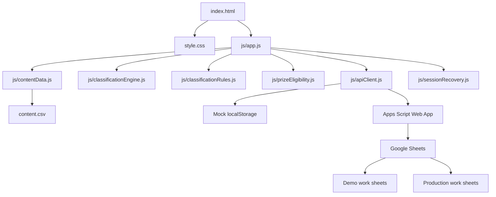

# Garmin Run 2026 Project Map

本文件是專案交接與維護地圖，用於讓 Codex 或後續開發者快速理解目前專案、修改 UI 與驗證功能。本文件以 **2026-11-04 的實際 repository 狀態**為準。

## 1. 專案現況

目前已完成：

- 原始五題測驗、三種跑者類型、永續旗標與平手規則。
- `start -> quiz -> result -> participation -> redemption` 流程。
- 賽後抽獎選填、姓名與 Email 驗證、自帶補水選擇。
- Mock Mode、Apps Script Demo Mode 與正式模式的環境分隔。
- Mock prize inventory、participants、allocations、inventory log。
- Apps Script Demo 後端、Google Sheets、LockService、request idempotency。
- 購物袋優先、一般獎品加權抽樣與庫存耗盡安全處理。
- 刷新回首頁、再測一次、品牌連結回首頁。
- 五種獎品圖片。
- 中英文界面切換。

目前階段：

- **Phase 1：完成**
- **Phase 2：完成**
- **Phase 3：Demo 後端骨架與 Demo 整合完成，部分正式管理驗證仍需人工確認**
- **Phase 4：進行中／Demo 驗收階段可進行**
- **Phase 5：尚未開始正式營運上線**

一般 GitHub Pages 網址只會使用 Mock Mode，不連接 Google Sheets。正式整合與正式個資收集只有網址或部署設定切換到 Production Mode 後才啟用。

## 2. 執行模式

```text
無 ?mode=apps-script-demo
  -> Mock Mode
  -> 瀏覽器 localStorage
  -> 顯示 MOCK MODE

?mode=apps-script-demo
  -> Apps Script Demo Mode
  -> 目前部署的 /exec Web App
  -> Demo Participants / DemoPrizes / DemoAllocations 工作表
  -> 不連接正式活動庫存

未來正式模式
  -> Apps Script Production Mode
  -> 正式工作表與正式個資設定
  -> 尚未核准前不得啟用
```

本地網址範例：

```text
http://localhost:8000/
http://localhost:8000/?mode=apps-script-demo
```

部署網址範例：

```text
https://yi-cheng-lin-ntu.github.io/GarminRunYourRunningGear/
https://yi-cheng-lin-ntu.github.io/GarminRunYourRunningGear/?mode=apps-script-demo
```

`MOCK_MODE` 與 `APPS_SCRIPT_DEMO_MODE` 的判斷位於 [js/apiClient.js](js/apiClient.js)。Apps Script Demo URL 是該檔案中的部署常數；正式部署不得把 Sheets 管理權限或秘密放入前端。

## 3. 系統架構



前端沒有 build pipeline：

- HTML、CSS 與 ES modules 可直接透過 GitHub Pages 部署。
- 修改後依 GitHub repository 的 `main` branch 發佈。
- Apps Script 是獨立部署；GitHub push 不會更新 Apps Script Web App。
- Apps Script 修改後必須儲存並建立「新增版本」部署。

## 4. 核心流程與狀態

### 流程畫面

```text
start -> quiz -> result -> participation -> redemption
```

- `start`：開始測驗。
- `quiz`：固定五題、每題單選。
- `result`：跑者類型與補水建議。
- `participation`：抽獎選填、自帶補水選擇、送出活動資料。
- `redemption`：顯示分配獎品、送完獎品狀態或其他後端成功結果。

### 前端 State

主要測驗狀態集中在 [js/app.js](js/app.js)：

- `currentQuestionIndex`
- `answers`
- `optionOrder`
- `result`
- `eligibility`
- `raffleOptIn`
- `hydrationCommitment`
- `submitInProgress`
- `requestId`
- `sessionId`

重新測驗或點選 GARMIN RUN 時會呼叫 `resetFlowState()`：

- 清除答案、結果、資格、抽獎資訊與表單內容。
- 清除獎品顯示。
- 新增新的 `sessionId`。
- 清除舊的 front-end recovery key。
- 新提交會建立新的 `requestId`。

重新整理不會依舊的 participantId 或 allocation result 自動進入 redemption；會回到首頁。bfcache 復原流程也會強制回首頁。

### Qualification State

[js/prizeEligibility.js](js/prizeEligibility.js) 集中計算：

```text
existingSelfHydration
  = 原五題測驗的 sustainability

hydrationCommitment
  existing | joined | considering

sustainabilityRewardEligible
  existingSelfHydration || hydrationCommitment === "joined"

premiumPrizeEligible
  existingSelfHydration === true
```

不可新增第四種跑者類型，不可把 sustainability 加進跑者分類分數，不可讓 `joined` 得到購物袋優先資格。

## 5. 分類與 CSV 資料契約

### 五題分類

- runner type：`experience`、`lifestyle`、`performance`
- 平手規則：`experience`、`lifestyle`、`performance`
- 選項 `traits` 決定分數。
- 選項 `sustainability=true` 設定獨立永續旗標，不得加入 `scores`。
- 本專案不新增 q6。

分類實作位於：

- [js/classificationEngine.js](js/classificationEngine.js)
- [js/classificationRules.js](js/classificationRules.js)
- [content.csv](content.csv)
- [js/contentData.js](js/contentData.js)

### CSV 必須保留欄位

`js/contentData.js` 會嚴格驗證每列欄位數與必要欄位；不要刪除 CSV header 或移動欄位順序。主要列型別：

| type | 用途 |
|---|---|
| `question` | 題目 |
| `option` | 選項、traits、sustainability、meme |
| `result` | 三種跑者結果 |
| `result_sustainability` | 永續版本結果 |
| `ui` | 完整中英文介面文案 |

新增 UI 文案時應優先新增到 CSV 的 `ui` 列，再由 `contentData.js` 建立 `uiContent`。不要增加第六題或改動 `[Runner type]-[tie break]` 既有規則。

## 6. UI 修改入口

### UI 直接可以微調的檔案

| 修改目的 | 主要位置 |
|---|---|
| 顏色、字體、間距、佈局、RWD | [style.css](style.css) |
| Screen 區塊、按鈕、表單、獎品卡片 | [index.html](index.html) |
| 題目、選項、跑者結果、UI 中英文文案 | [content.csv](content.csv) |
| 領獎頁標題／暫停文案顯示邏輯 | [js/app.js](js/app.js) |
| 獎品圖片與 Mock 獎品名稱 | [js/apiClient.js](js/apiClient.js)、[assets/prizes/](assets/prizes/) |

### 主要視覺設定

[style.css](style.css) 的 `:root` 定義目前品牌色：

```css
#080b0d  /* 主黑色 */
#d6f2ff  /* 淡藍 */
#00ff19  /* 螢光綠 */
```

領獎頁永續版本使用：

```css
background: #00ff19;
color: #080b0d;
```

台北道路地圖為背景裝飾，不是資訊層。修改時不要破壞 `.screen` 顯示、focus state、手機 375px 最小寬度與桌面版 `620px` 主內容寬度。

### 建議微調範圍

- 修改文字：優先 `content.csv` 與 HTML fallback。
- 修改間距、字級、卡片比例：優先 CSS variables 或 CSS selectors。
- 修改 DOM `id`、`data-*`、class：先搜尋所有 JavaScript／CSS selector。
- 不要將獎品資格、庫存扣除、分類邏輯混進 UI 修改。

## 7. Mock Mode

Mock API 位於 [js/apiClient.js](js/apiClient.js)，右上角測試工具位於 [index.html](index.html) 且由 [js/app.js](js/app.js) 控制。

Mock tool 支援：

- 購物袋有庫存
- 購物袋耗盡
- 一般獨立獎品耗盡
- 重置初始庫存
- 修改五項剩餘數量
- 清除測試資料
- 查看 prizes、participants、allocations、inventory log

Mock 資料儲存在瀏覽器：

```text
garminRunMockRequests
garminRunMockStock
garminRunMockParticipants
garminRunMockAllocations
garminRunMockInventoryLog
garminRunDemoAllocation
garminRunPendingRequest
```

資料生命週期：

- 網頁重新整理：保留 Mock stock／歷史紀錄，回到首頁。
- 再測一次：清除前端測驗 state，不刪除 Mock 歷史紀錄。
- 重啟 local HTTP server：不清除瀏覽器 localStorage。
- 清除測試資料／清除瀏覽器 website data：清除 Mock 資料。
- 無痕視窗／不同瀏覽器／不同裝置：不共享資料。

Mock mode 僅供功能驗收，不代表正式抽獎登記。

## 8. Apps Script Demo 後端

後端文件位於：

- [apps-script/Code.gs](apps-script/Code.gs)：doGet、doPost、lock routing。
- [apps-script/Validation.gs](apps-script/Validation.gs)：答案、資格、個資與 payload 驗證。
- [apps-script/Allocation.gs](apps-script/Allocation.gs)：request replay、加權抽樣、庫存扣除。
- [apps-script/Setup.gs](apps-script/Setup.gs)：工作表初始化與獎品初始化。
- [apps-script/Inventory.gs](apps-script/Inventory.gs)：庫存調整、暫停、恢復、一致性、匯出。
- [apps-script/README.md](apps-script/README.md)：部署操作。

Google Sheets 工作表：

正式：

```text
Participants
Prizes
Allocations
InventoryLog
Requests
Settings
AdminAudit
```

Demo：

```text
DemoParticipants
DemoPrizes
DemoAllocations
DemoInventoryLog
DemoRequests
```

正式與 Demo 必須保持分離。Apps Script Demo submission 由 `payload.demoMode=true` 進入 Demo 工作表。

## 9. 獎品與分配規則

五項獎品：

| prizeId | 中文名稱 | 類別 | 初始數量 |
|---|---|---|---:|
| `cap` | Garmin 牛仔帽／漁夫帽 | general | 150 |
| `soft_cup` | Garmin 軟水杯 | general | 260 |
| `socks` | Garmin 襪子 | general | 470 |
| `arm_sleeves` | Garmin 袖套 | general | 125 |
| `shopping_bag` | Garmin 鏤空購物袋 | premium | 120 |

分配規則：

1. `existingSelfHydration=true` 優先嘗試購物袋。
2. 購物袋無庫存時轉一般獎品池。
3. `joined`／`considering` 一律一般獎品池。
4. 一般池依剩餘庫存加權：剩餘零者機率為零。
5. 同一 `requestId` 不可重複扣庫存。
6. 一般獎品及購物袋全部不能分配時仍建立 Participant／Request，回傳 `allocationStatus=paused`，領獎頁仍要顯示。
7. paused 結果不能建立 prize Allocation、扣庫存或顯示虚構獎品。
8. 不允許負庫存。

演算法位於 [js/apiClient.js](js/apiClient.js) Mock 版及 [apps-script/Allocation.gs](apps-script/Allocation.gs) Production/Demo 版。前端永遠不能決定正式獎品結果。

## 10. API 與提交契約

前端 Mock／Apps Script 共用 payload 方向：

```json
{
  "requestId": "uuid",
  "sessionId": "uuid",
  "runnerType": "experience",
  "existingSelfHydration": false,
  "hydrationCommitment": "considering",
  "sustainabilityRewardEligible": false,
  "premiumPrizeEligible": false,
  "raffleOptIn": false,
  "name": "",
  "email": "",
  "answers": {},
  "demoMode": true
}
```

Apps Script 必須依 `answers` 伺服器端重新驗證：

- runnerType
- sustainability
- premium eligibility
- hydration commitment 組合

成功分配回傳：

```json
{
  "ok": true,
  "participantId": "...",
  "requestId": "...",
  "allocationStatus": "allocated",
  "runnerType": "experience",
  "prize": {
    "prizeId": "soft_cup",
    "nameZh": "...",
    "nameEn": "...",
    "imagePath": ".../"
  },
  "sustainabilityRewardEligible": false
}
```

獎品送完回傳：

```json
{
  "ok": true,
  "participantId": "...",
  "requestId": "...",
  "allocationStatus": "paused",
  "prize": null,
  "message": {
    "zh": "現場獎品已贈送完畢，謝謝您的參與~",
    "en": "All prizes have been given out. Thank you for participating!"
  }
}
```

前端應顯示 paused 的領獎頁，不應把後端暫停視為表單提交失敗或網路錯誤。

## 11. Idempotency 與狀態恢復

- 每次新測驗產生新 sessionId。
- 每次送出產生或重用 requestId。
- 同一次提交重試使用同一 requestId。
- Apps Script 使用 LockService 保護 replay、庫存和 allocation。
- Mock 使用瀏覽器 Web Locks／Promise queue 保護重複呼叫。
- pending request 保留在 `garminRunPendingRequest`。
- timeout 後仍可透過 GET recovery 查詢 request。
- refresh 不刪除正式或 Demo 後端資料。
- 清除瀏覽器 recovery key 不刪除後端 Participant／Allocation。
- 不得依 localStorage 裡的 prizeId 判定真實獒品。

## 12. 測試方式

啟動本地網站：

```bash
python3 -m http.server 8000
```

執行自動化測試：

```bash
node --test tests/*.test.mjs
```

測試涵蓋：

- 三種 runner type 資格。
- existing／joined／considering。
- 購物袋優先與 fallback。
- 一般 pool 耗盡。
- 負庫存防護。
- 相同 requestId replay。
- raffle name／email／opt-out。
- 30,000 次 weighted sample 模擬。

目前已通過 11 個測試；Mock UI、真實手機觸控、Apps Script Demo manual test 仍須人工驗收。

## 13. UI 交接與安全邊界

Codex 可以修改：

- 顏色、字體、間距、卡片比例、動態效果。
- 中英文文案、但修改後確認 CSV 欄位數一致。
- 圖片載入樣式與 placeholder。
- Participation／Redemption RWD。
- Loading／error／validation 的視覺呈現。
- 重新整理、再測一次與 submit 重複防止的 UI 展示。

Codex 不應自行修改：

- `classifyAnswers()` 計分或 tie-break。
- 加入第四種 runner type。
- `premiumPrizeEligible` 的資格來源。
- 加入永續行動使 runner 得到購物袋優先。
- 一般獎品加權公式。
- Apps Script `LockService` idempotency。
- 正式／Demo Sheet 分離。
- 正式個資條款或 consent UX。
- 正式 inventory 數量。

## 14. Phase 4 剩餘人工驗收

目前仍需確認：

- 購物袋耗盡時 existing runner 一般池 fallback。
- 一般獎品完全耗盡時仍進入 paused redemption。
- paused 時 Participants／Requests 記錄正確、不建立 Allocation／扣庫存。
- joined 永遠不取得購物袋。
- Demo 與正式 Sheets 隔離。
- 重複 requestId 不重複扣庫存。
- Demo 管理選單、庫存調整、暫停／恢復、CSV 匯出一致。
- 375px、390px、430px、768px、桌機版面。
- 中英文切換與鍵盤操作。
- `GARMIN RUN`、`再測一次`、刷新都回到首頁。

## 15. Phase 5 正式上線前置條件

尚未進行正式營運：

- Garmin 核准的個資告知版本。
- 個資保存期限與刪除流程。
- 正式 Garmin 帳號權限。
- 正式獎品初始庫存核定。
- 正式 Prizes 圖片與文案確認。
- 正式 Web App Deployment URL。
- 正式 Sheets 建立與 Demo 資料清除。
- 正式網路中斷 SOP。
- `processing` request partial-write 修復驗證。
- 管理員操作權限與操作紀錄人工驗收。
- 正式活動宣告批准。

只有上述條件完成後，才能將一般 GitHub Pages 網址切換或設定為 Production Mode。

## 16. 安全與個資提醒

- 不要把 Google Sheet 管理 token、API secret、管理密碼放入前端。
- 姓名與 Email 只在 raffle opt-in 時傳送。
- 取消抽獎後不得送出先前輸入的個資。
- 不把姓名／Email 放入 URL query。
- 不在 console、analytics 或公開畫面記錄個資。
- 不聲稱個資告知已符合 Garmin 政策，除非已取得正式核准。
- Demo 名稱、Email 須使用測試資料。

## 17. 交接 Codex 開始指令

建議接手後先執行：

```bash
git status
python3 -m http.server 8000
node --test tests/*.test.mjs
```

接著先開兩個網址驗收：

```text
http://localhost:8000/
http://localhost:8000/?mode=apps-script-demo
```

若要微調 UI，先只修改 CSS／HTML／`content.csv`，完成後重新執行測試；不要順手修改分類、獎品資格、庫存或 Apps Script。Mock Mode 可自由驗收，Apps Script Demo 只測試資料，不碰正式 Sheets。
